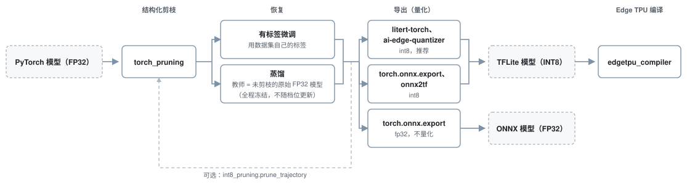

# INT8 Pruning Pipeline

[English](README.md) | **简体中文**

[](LICENSE)
[](pyproject.toml)

INT8 Pruning Pipeline 是一个 Python 库，把训练好的 PyTorch 模型依次经过结构化剪枝、精度恢复和导出，
各阶段都是由脚本直接调用的普通函数。输入 FP32 模型，输出 INT8 TFLite（可再编译给 Edge TPU）
或 FP32 ONNX。



结构化剪枝是 DepGraph，由 [`torch_pruning`](https://github.com/VainF/Torch-Pruning) 实现。
恢复有两条路线：在数据集自己的标签上微调，或者向冻结的未剪枝原网络蒸馏。默认的 int8 导出路径是
`litert-torch` 配 `ai-edge-quantizer`，可选的另一条是 `torch.onnx.export` 配 `onnx2tf`；第三条路径
导出 fp32 ONNX 图。六个示例在十一个公开基线上把整个库从头跑到尾，覆盖分类、COCO 检测、
行人 Re-ID 和开放词表识别。

## 快速上手

`examples/minimal.py` 用一个小 CNN 和随机数据，在 CPU 上几秒钟走完每个阶段。后面几条命令在
Flowers-102 上把 MobileNetV2 从头走到尾，它是下载脚本能取的数据集里最小的一个；只剪一个比例、
只恢复一个 epoch，以缩短运行时间。

```bash
./scripts/setup_env.sh                       # 建 ./pruning-env
source ./pruning-env/bin/activate
python examples/minimal.py
mkdir -p data/datasets
python examples/download_datasets.py --dataset flowers102   # 约 330 MB
python examples/cnn_backbones.py fetch-baseline --model mobilenetv2 --dataset flowers102
python examples/cnn_backbones.py prune --model mobilenetv2 --dataset flowers102 \
    --ratios 0.5 --epochs 1
python examples/cnn_backbones.py int8 --dataset flowers102 \
    --pt outputs/pytorch_pruned/mobilenetv2_flowers102_pruned50pct_magnitude_l2.pt
```

每个示例都支持 `--help`。给 `int8` 加上 `--edgetpu` 会把结果再编译成 Edge TPU 产物，
需要 `edgetpu_compiler`。环境、数据集与每个示例的完整说明：
**[`docs/SETUP.zh-CN.md`](docs/SETUP.zh-CN.md)**。

## 用在你自己的模型上

模型、数据和指标由调用脚本提供：

```python
import copy
import torch
import int8_pruning

int8_pruning.seed_everything(42)
model = ...                                    # 任意 nn.Module，eval 模式
teacher = copy.deepcopy(model)                 # 只有蒸馏才需要
example = torch.randn(1, 3, 224, 224)

info = int8_pruning.prune(model, example, 0.5, ignored_layers=[model.classifier])
opt = torch.optim.SGD(model.parameters(), lr=0.01, momentum=0.9)   # 剪枝之后再建
int8_pruning.finetune(model, train_loader, 30, optimizer=opt,
                      scheduler=torch.optim.lr_scheduler.CosineAnnealingLR(opt, 30),
                      evaluate=lambda: {"top1": top1(model, val_loader)}, select="top1")
# 没有标签时：int8_pruning.distill(model, teacher, unlabelled_loader, 10, optimizer=opt)

calib = int8_pruning.export.image_folder("calibration_images/", 100, 224, mean, std)
int8_pruning.export_int8(model, calib, "outputs/tflite_int8_litert/model_int8.tflite")
int8_pruning.compile_edgetpu("outputs/tflite_int8_litert/model_int8.tflite")   # 可选
```

公开接口是 `int8_pruning.__all__` 里列出的名字；以下划线开头的模块是内部实现。`ratio` 是剪掉的参数比例，以调用前的模型为基准。
模型还有其他需要时，用下表中的选项，每一项都有示例演示：

| 模型的情况 | 传什么 | 示例 |
|---|---|---|
| 有输出宽度不能变的头 | `ignored_layers=[head]` | 全部 |
| 训练损失不是 (image, label) 上的 CrossEntropy | `finetune(..., train_step=fn)`，`fn(model, batch) -> loss` | [`ssdlite.py`](examples/ssdlite.py)、[`efficientdet.py`](examples/efficientdet.py) |
| 没有可训练的标签 | `distill(student, teacher, loader, ...)` | [`clip_rn50.py`](examples/clip_rn50.py)、[`relu_clip.py`](examples/relu_clip.py)、[`youreid.py`](examples/youreid.py) |
| 原样无法 trace | `prune(..., traced=wrapper)`，一个共享其子模块的 module | [`ssdlite.py`](examples/ssdlite.py) |
| 比例只按模型的一部分计算 | `prune(..., scope=lambda m: m.backbone)` | [`ssdlite.py`](examples/ssdlite.py)、[`efficientdet.py`](examples/efficientdet.py) |
| 剪枝前已经用别的方式缩小过 | `prune(..., dense_params=n)` | [`youreid.py`](examples/youreid.py) `--embed-dim` |
| 分几轮剪、轮间恢复 | `for ratio, info in int8_pruning.prune_trajectory(model, example, ratios)` | [`cnn_backbones.py`](examples/cnn_backbones.py) `--iterative` |
| 会下降成 Edge TPU 不映射的算子 | `export_int8(..., graph_patches=[...])` | [`ssdlite.py`](examples/ssdlite.py)、[`efficientdet.py`](examples/efficientdet.py)、[`youreid.py`](examples/youreid.py) |

模型结构与这些工具的要求差得较远时（各工具的仓库写明了要求），可以先蒸馏成一个 CNN 学生，
参考 [`jiaheguo521/relu-clip`](https://github.com/jiaheguo521/relu-clip)。

## 各阶段如何工作

剪枝是 data-free 的：重要性准则全部只从权重计算，`example_inputs` 只用来 trace。算力主要花在恢复上。
蒸馏不需要标注，因为教师是剪枝之前对原网络取的 `copy.deepcopy`。蒸馏步比有标签步更贵，
而且差距随剪枝加深而拉大，因为学生变小时教师保持原大小。

阶梯是一组档位：把一个模型剪到一个目标参数削减率，再恢复，算一档。默认每一档都从稠密模型独立剪一次。
`prune_trajectory` 则走一条轨迹，把每一档恢复后的模型送入下一轮剪枝。

量化默认是 per-channel 的。`litert-torch` 配 `ai-edge-quantizer` 是推荐路径：在检测上它把整张图
都映射到加速器上。两条 int8 路径对同一张图的下降方式不同，一个模型有多少能上到加速器取决于路径。

剪枝、恢复、导出在任何机器上都能跑，终点是 int8 `.tflite` 或 fp32 `.onnx`。编译成 Edge TPU 产物
（`int8_pruning.compile_edgetpu`，需要 `edgetpu_compiler`）和在 Coral 上测延迟（`int8_pruning.latency`）是之后的可选步骤。

## 示例

| 示例 | 基线 | 任务 | 恢复 |
|---|---|---|---|
| [`cnn_backbones.py`](examples/cnn_backbones.py) | MobileNetV2、EfficientNet-Lite0、MnasNet、SqueezeNet、ResNet-50 | ImageNet / Flowers-102 / iNat Plantae top-1 | 有标签 |
| [`efficientdet.py`](examples/efficientdet.py) | EfficientDet-Lite1、Lite2 | COCO 检测（mAP） | 有标签 |
| [`ssdlite.py`](examples/ssdlite.py) | SSDLite320-MobileNetV3-Large | COCO 检测（mAP） | 有标签 |
| [`clip_rn50.py`](examples/clip_rn50.py) | CLIP RN50 图像塔 | 开放词表 zero-shot | 蒸馏 |
| [`relu_clip.py`](examples/relu_clip.py) | [relu-clip](https://github.com/jiaheguo521/relu-clip) 的 EfficientNet-Lite4 学生 | 开放词表 zero-shot | 蒸馏 |
| [`youreid.py`](examples/youreid.py) | YouReID baseline_lite | 行人 Re-ID（mAP / CMC） | 蒸馏 |

每个示例都有同样三个子命令：`fetch-baseline` 写出稠密模型，`prune` 把它剪到 `--ratios` 里的每个比例并恢复，
`int8` 导出一个剪枝后的模型并评测。`clip_rn50.py` 多一个 `text-embeddings`，给它的 zero-shot 分类器用。
剪枝后的模型文件命名为

```
<stem>_pruned<P>pct_<criterion>[_iter][_full].pt
```

`<stem>` 是基线名加恢复所用的数据（`mobilenetv2_imagenet`、`efficientdet_lite1_coco-train2017`），
`<P>` 是剪掉的参数百分比，`<criterion>` 是重要性准则。`_iter` 表示一条轨迹，`_full` 表示按全模型
而不是 backbone 计算比例的 EfficientDet 阶梯（`--scope full`）。两个检测示例默认按 backbone 计算 `<P>`，
其余示例按全模型，所以文件名只在同一示例内可比；每次运行的 JSON 日志记录了实际达成的比例。

## 相关论文

INT8 Pruning Pipeline 是下面论文所用工具链的扩展：

> M. Zouhdi, J. Guo, R. Hammadi, B. Sun, P. Leleux, T. Kłoda, M. Caccamo.
> *Pruning of Deep Neural Networks for Real-Time Execution on Edge TPU.*
> 29th Euromicro Conference on Digital System Design (DSD), Kraków, Poland, 2026.

## 运行测试

```bash
python3 -m unittest discover -s tests
```

测试在小 CNN 上跑剪枝、恢复、导出，对每个示例跑到 `--help` 为止，并检查文档：链接、图片、
中英对齐，以及 `scripts/` 下每个脚本在文档里都有说明。测试只依赖标准库；需要 torch 或导出相关包的
用例在缺包时跳过。

## 仓库结构

```
src/int8_pruning/          库本体：import int8_pruning
  pruning/                 prune、prune_trajectory、count_params
  recovery/                finetune、distill
  export/
    _int8.py               export_int8：导出 int8 TFLite，按 backend= 分派
    _litert.py             backend="litert"（默认）：litert-torch + ai-edge-quantizer
    _onnx2tf.py            backend="onnx2tf"：torch.onnx.export + onnx2tf
    _onnx.py               export_onnx：导出 fp32 ONNX
    _calibration.py        image_folder、normalize_nhwc：校准集
    _patches.py            se_mean_pool、adaptive_max_pool：导出期间临时替换的模块改写
    _edgetpu_fixups.py     量化后对 .tflite 的改写
    _outputs.py            嵌套模型输出的展平与命名
    _tflite_size.py        .tflite 字节预算
  compilation/             compile_edgetpu：调用 edgetpu_compiler
  evaluation/              make_interpreter、run_tflite、latency；可单独按路径运行
  _seed.py                 seed_everything
examples/                  每个模型家族一个脚本、共用的数据集代码、数据集下载脚本
scripts/setup_env.sh       建虚拟环境
tests/                     库与示例的测试
docs/                      环境搭建指南与流水线示意图
```

流水线的每个阶段是一个包，它的 `__init__.py` 只从下划线开头的模块转出名字；库里其余的代码都放在这类模块里。
公开名字的清单在 [`tests/test_public_api.py`](tests/test_public_api.py) 里。

`outputs/`（流水线产物）和 `data/`（数据集）是生成物，已列入 .gitignore。

## 许可与致谢

Apache-2.0，见 [`LICENSE`](LICENSE)。发布的模型权重受其上游来源各自的条款约束。

本工作在 **LAAS-CNRS**（法国图卢兹）完成，计算在 LAAS-CNRS 的算力设施上完成，
由 **Tomasz Kłoda** 指导。这项工作的研究方向由他推荐，他也是 DSD 2026 论文的共同作者。
实习期间，他给了我很大的研究自由，同时在需要时随时提供指导。

本库构建在这些工作之上：`torch_pruning`、
`litert-torch` 与 `ai-edge-quantizer`（google-ai-edge）、`timm`、
`efficientdet-pytorch`、`open_clip`、`deep-person-reid` 与 `google-coral`。
